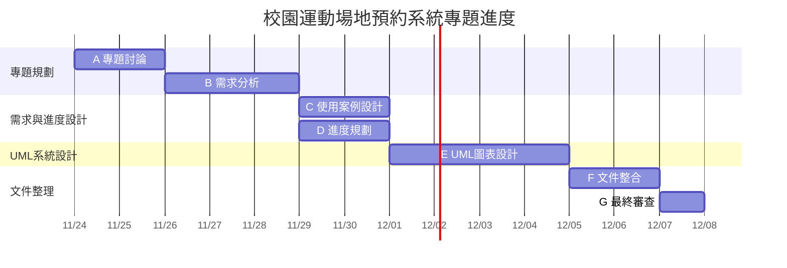
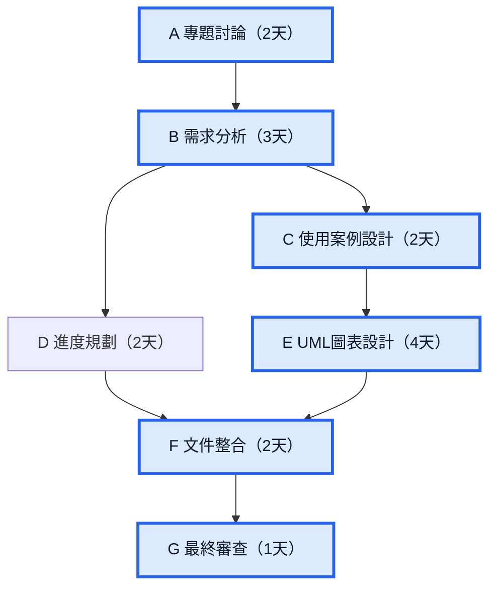

# 校園運動場地預約系統

## 一、小組基本資料

- 組長：王昱翔
- 組員：陳政佑、蔡哲恩、巫亭叡

## 二、專題名稱

校園運動場地預約系統
(Campus Sports Facility Reservation System)

## 三、專題動機

校園運動場地是學生進行體育活動的重要資源，
但傳統場地借用方式可能需要現場登記或人工詢問，
學生無法即時掌握場地使用情況，
容易發生時間衝突或重複預約的問題。

因此，本專題希望設計一套校園運動場地預約系統，
讓學生能透過線上平台查詢場地資訊、
選擇可用時段並完成預約，
提升場地使用效率及管理便利性。

## 四、專題目標

1. 提供學生方便的線上場地查詢服務。
2. 讓學生能夠預約及取消運動場地。
3. 避免同一場地於相同時段發生重複預約。
4. 提供個人預約紀錄查詢功能。
5. 協助管理員管理場地及開放時段。

## 五、系統主要功能

### 1. 場地查詢
- 查看校園運動場地清單。
- 查看場地類型、位置及開放時段。
- 查詢指定日期及時段的預約情況。

### 2. 場地預約
- 選擇想要使用的運動場地。
- 選擇預約日期與時段。
- 系統檢查時段是否可用。
- 確認並建立預約紀錄。

### 3. 取消預約
- 查看個人預約清單。
- 選擇尚未開始的預約進行取消。
- 取消後釋放該預約時段。

### 4. 預約紀錄查詢
- 查看目前的預約資訊。
- 查看過去的預約紀錄。

### 5. 場地管理
- 管理員新增或修改場地資料。
- 設定場地開放時間。
- 查看場地預約情況。

## 六、預期成果

本專題預計完成校園運動場地預約系統的
需求分析與系統設計，包含專題規劃、
需求規格、使用案例圖、UML 類別圖、
循序圖與活動圖，並以 GitHub 整理專題成果。

## 七、小組工作分配

| 組員姓名 | 負責工作 | 工作內容 |
|---|---|---|
| 王昱翔（組長） | 專案管理與整合 | 規劃專題進度、製作甘特圖及 PERT/CPM 圖、整合 GitHub 專案文件 |
| 陳政佑 | 系統需求分析 | 整理功能性與非功能性需求、設計使用案例圖及使用案例說明 |
| 蔡哲恩 | UML 系統設計 | 設計 UML 類別圖、繪製三個使用案例的循序圖 |
| 巫亭叡 | 系統流程設計 | 繪製三個使用案例的活動圖、協助檢查圖表及整理專題文件 |

所有組員共同參與專題討論、需求確認及成果審查。

## 八、專題甘特圖（Gantt Chart）

本專題依照需求分析、系統設計及成果整理等階段規劃工作進度，預計以 14 天完成主要規劃與設計工作。

## 九、PERT/CPM 專案工作流程圖

本專題使用 PERT/CPM 圖分析各項工作之間的先後關係，並找出影響專題完成時間的關鍵路徑。

### 工作項目與預計時間

| 代號 | 工作項目 | 預計天數 | 前置工作 |
|---|---|---|---|
| A | 專題討論 | 2 天 | 無 |
| B | 需求分析 | 3 天 | A |
| C | 使用案例設計 | 2 天 | B |
| D | 進度規劃 | 2 天 | B |
| E | UML 圖表設計 | 4 天 | C |
| F | 文件整合 | 2 天 | D、E |
| G | 最終審查 | 1 天 | F |

### 關鍵路徑分析

關鍵路徑為：

A → B → C → E → F → G

專題預計完成時間：

2 + 3 + 2 + 4 + 2 + 1 = 14 天

工作 D（進度規劃）可以與工作 C（使用案例設計）平行進行，因此不影響整體完成時間。

關鍵路徑上的工作若發生延誤，將可能影響專題的最終完成時間。

## 十、作業二總結

本次作業完成四位組員的工作分配、專題甘特圖及 PERT/CPM 圖。

透過工作分配明確區分每位組員的負責項目，利用甘特圖規劃工作時程，並透過 PERT/CPM 圖分析工作之間的依賴關係及關鍵路徑，以確保專題能依照規劃順利進行。
