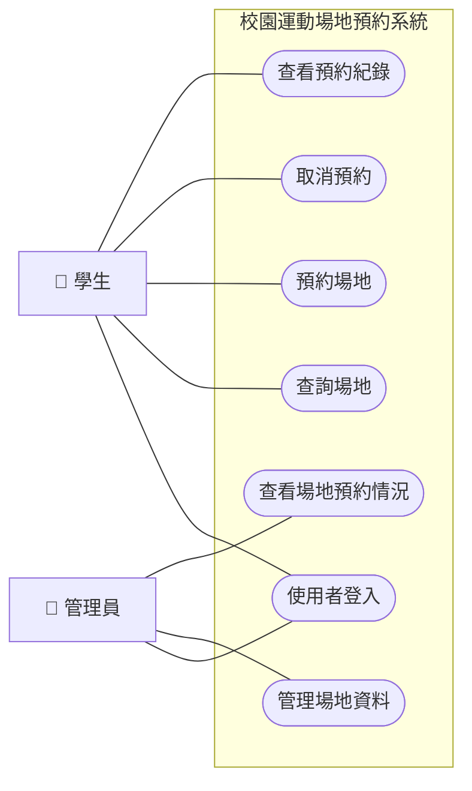

# 作業三：系統需求分析與使用案例設計

## 一、專題名稱

校園運動場地預約系統  
(Campus Sports Facility Reservation System)

## 二、系統簡介

本系統旨在提供學生方便的校園運動場地預約服務。

學生可以透過系統查詢籃球場、羽球場、排球場等場地資訊，查看可預約時段，並進行線上預約或取消預約。

管理員則可以管理場地資料、設定開放時段及查看場地預約情況，以提升校園運動場地的使用效率。

## 三、功能性需求（Functional Requirements）

功能性需求是指系統必須提供的具體功能。

| 編號 | 功能性需求 | 說明 |
|---|---|---|
| FR-01 | 使用者登入 | 學生及管理員可以使用帳號和密碼登入系統 |
| FR-02 | 場地查詢 | 學生可以查詢場地類型、位置、日期及可預約時段 |
| FR-03 | 場地預約 | 學生可以選擇場地與時段，系統確認無衝突後建立預約 |
| FR-04 | 取消預約 | 學生可以取消尚未開始的個人預約，系統將釋放該時段 |
| FR-05 | 場地管理 | 管理員可以新增或修改場地資料，並設定開放時段 |

## 四、非功能性需求（Non-Functional Requirements）

非功能性需求是指系統在效能、安全性及使用體驗等方面應達到的標準。

| 編號 | 非功能性需求 | 說明 |
|---|---|---|
| NFR-01 | 系統效能 | 一般查詢操作應在 3 秒內完成 |
| NFR-02 | 操作便利性 | 系統介面應簡單易懂，方便學生操作 |
| NFR-03 | 資料安全性 | 使用者密碼必須安全儲存，且只有本人或授權管理員可存取相關資料 |
| NFR-04 | 系統可靠性 | 系統不得允許同一場地在相同時段發生重複預約 |
| NFR-05 | 裝置相容性 | 系統應支援電腦、平板及手機瀏覽器操作 |

## 五、使用案例圖（Use Case Diagram）

本系統主要包含兩種使用者角色：

1. 學生：可以登入系統、查詢場地、預約場地、取消預約及查看預約紀錄。
2. 管理員：可以登入系統、管理場地資料及查看場地預約情況。

以下使用 Mermaid 流程圖語法呈現使用案例關係。

## 六、使用案例一：查詢場地

| 項目 | 內容 |
|---|---|
| 使用案例編號 | UC-01 |
| 使用案例名稱 | 查詢場地 |
| 主要參與者 | 學生 |
| 前置條件 | 學生已成功登入系統 |
| 觸發條件 | 學生選擇查詢場地功能 |
| 後置條件 | 系統顯示符合條件的場地及可預約時段 |

### 主要流程

1. 學生登入系統。
2. 學生進入場地查詢頁面。
3. 學生選擇場地類型、日期及時段。
4. 系統查詢符合條件的場地資料。
5. 系統顯示場地資訊及可預約狀態。
6. 學生查看查詢結果。

### 例外流程

- 若沒有符合條件的場地，系統顯示「查無符合條件的場地」。
- 若所選時段已被預約，系統標示為不可預約。

## 七、使用案例二：預約場地

| 項目 | 內容 |
|---|---|
| 使用案例編號 | UC-02 |
| 使用案例名稱 | 預約場地 |
| 主要參與者 | 學生 |
| 前置條件 | 學生已登入系統，且場地有可預約時段 |
| 觸發條件 | 學生選擇預約場地功能 |
| 後置條件 | 系統成功建立預約紀錄，並更新場地時段狀態 |

### 主要流程

1. 學生登入系統。
2. 學生查詢並選擇想要預約的運動場地。
3. 學生選擇預約日期及時段。
4. 系統檢查該場地時段是否可預約。
5. 系統顯示預約確認資訊。
6. 學生確認預約。
7. 系統再次確認沒有預約衝突。
8. 系統建立預約紀錄。
9. 系統顯示「預約成功」。

### 例外流程

- 若場地時段已被預約，系統顯示「該時段已被預約，請重新選擇」。
- 若學生取消確認，系統不建立預約紀錄。
- 若系統無法儲存預約資料，顯示「預約失敗，請稍後再試」。

## 八、使用案例三：取消預約

| 項目 | 內容 |
|---|---|
| 使用案例編號 | UC-03 |
| 使用案例名稱 | 取消預約 |
| 主要參與者 | 學生 |
| 前置條件 | 學生已登入系統，且擁有尚未開始的預約紀錄 |
| 觸發條件 | 學生選擇取消預約功能 |
| 後置條件 | 系統更新預約狀態並釋放原預約時段 |

### 主要流程

1. 學生登入系統。
2. 學生進入個人預約紀錄頁面。
3. 系統顯示學生目前的預約資料。
4. 學生選擇要取消的預約。
5. 系統確認該預約尚未開始且可以取消。
6. 系統顯示取消確認訊息。
7. 學生確認取消。
8. 系統更新預約狀態為「已取消」。
9. 系統釋放該場地時段。
10. 系統顯示「取消成功」。

### 例外流程

- 若預約時段已開始，系統顯示「無法取消已開始的預約」。
- 若預約已被取消，系統顯示「此預約已取消」。
- 若學生放棄取消操作，系統保留原預約。

## 九、作業三總結

本次作業完成校園運動場地預約系統的需求分析與使用案例設計。

內容包含五項功能性需求、五項非功能性需求、一張使用案例關係圖，以及三個主要使用案例的詳細說明。

透過本次需求分析，可以明確了解學生與管理員的操作需求，並作為後續 UML 類別圖、循序圖及活動圖設計的基礎。
