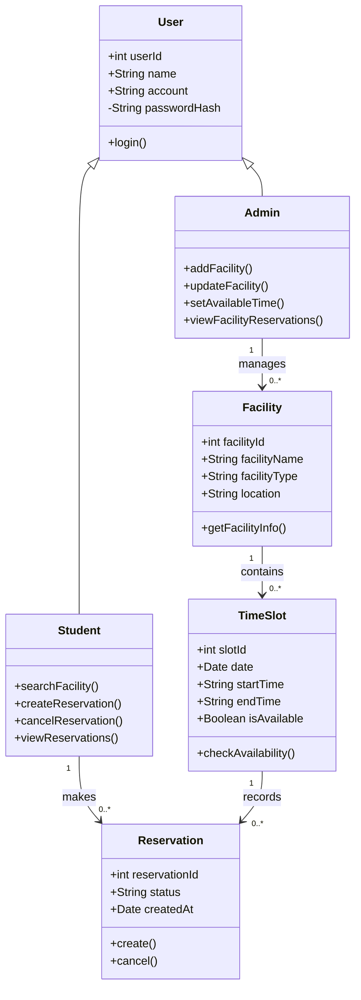
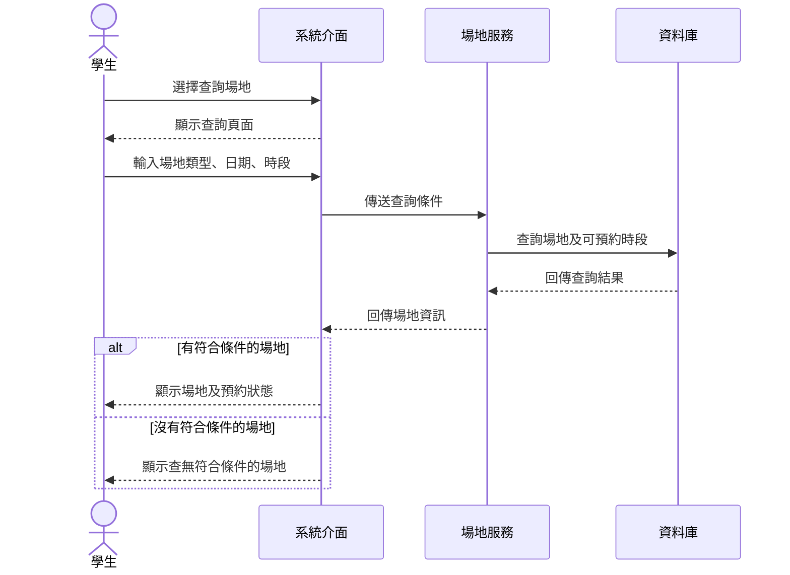
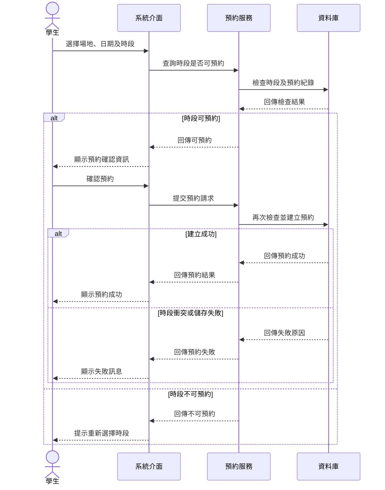
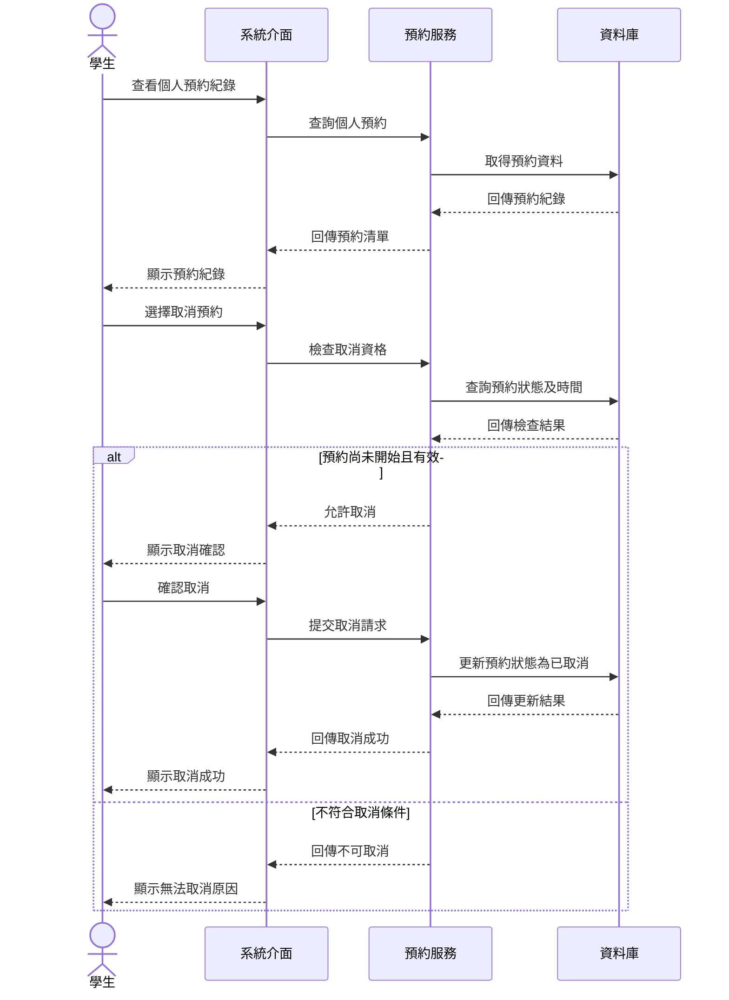
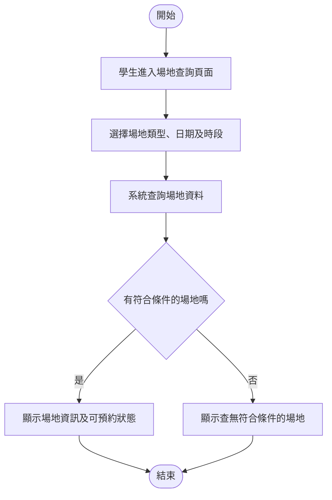
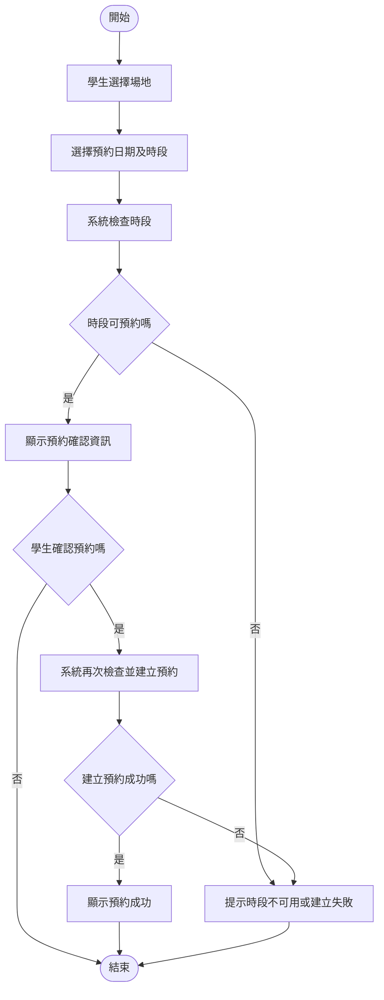
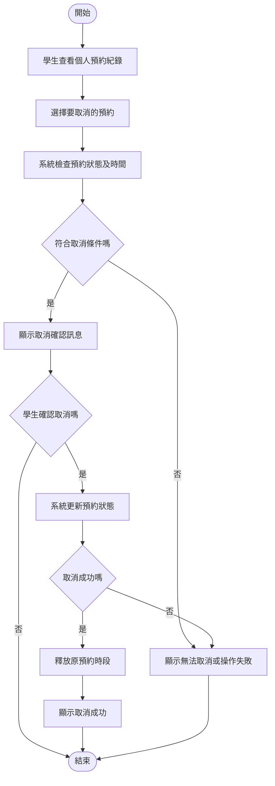

# 作業四：UML 系統設計

## 一、專題名稱

校園運動場地預約系統  
(Campus Sports Facility Reservation System)

## 二、系統設計說明

本專題依據作業三的需求分析與使用案例，
進行 UML 系統設計。

設計內容包含：
1. UML 類別圖（Class Diagram）
2. 三個使用案例的循序圖（Sequence Diagram）
3. 三個使用案例的活動圖（Activity Diagram）

本次選擇以下三個主要使用案例：
- UC-01：查詢場地
- UC-02：預約場地
- UC-03：取消預約

## 三、UML 類別圖（Class Diagram）

類別圖用來描述系統中的主要類別、
類別屬性、方法及彼此之間的關係。

### 類別說明

| 類別 | 功能說明 |
|---|---|
| User | 儲存使用者基本資料及登入功能 |
| Student | 提供學生查詢、預約及取消功能 |
| Admin | 提供管理員管理場地的功能 |
| Facility | 儲存運動場地的基本資訊 |
| TimeSlot | 儲存各場地的日期與時段 |
| Reservation | 儲存預約紀錄及預約狀態 |

### 類別關係

1. Student 和 Admin 繼承 User。
2. Admin 可以管理多個 Facility。
3. Facility 可以包含多個 TimeSlot。
4. Student 可以建立多筆 Reservation。
5. 每筆 Reservation 對應一個 TimeSlot。

系統會檢查有效預約紀錄，
避免相同場地與時段被重複預約。

## 四、循序圖（Sequence Diagram）

循序圖用來表示使用者、系統介面、
系統服務及資料庫之間的互動順序。

### 4.1 UC-01 查詢場地循序圖

### 4.2 UC-02 預約場地循序圖

### 4.3 UC-03 取消預約循序圖

## 五、活動圖（Activity Diagram）

活動圖用來表示各功能的操作流程、
執行步驟及條件判斷。

### 5.1 UC-01 查詢場地活動圖

### 5.2 UC-02 預約場地活動圖

### 5.3 UC-03 取消預約活動圖

## 六、使用案例與 UML 圖表對照

| 使用案例 | 循序圖 | 活動圖 |
|---|---|---|
| UC-01 查詢場地 | 4.1 | 5.1 |
| UC-02 預約場地 | 4.2 | 5.2 |
| UC-03 取消預約 | 4.3 | 5.3 |

## 七、作業四總結

本次作業完成校園運動場地預約系統的 UML 系統設計。

包含一張 UML 類別圖、三張循序圖及三張活動流程圖，共七張圖表。

類別圖說明系統的主要類別與相互關係；
循序圖呈現使用者與系統之間的互動順序；
活動圖則說明各項功能的執行步驟及條件判斷。

透過本次系統設計，可以進一步了解校園運動場地預約系統的資料結構與功能流程，作為後續系統實作的設計依據。
